# 🌕 MoonFall: Lunar Outpost Survival Simulator
### NASA International Space Apps Challenge 2025

---

## 📖 Project Overview
**MoonFall** is an interactive, browser-based lunar outpost survival simulator developed for the **NASA International Space Apps Challenge**. 

Situated on the rim of the Moon's South Pole **Shackleton Crater**, players assume the role of Artemis Base Commander. When an unexpected 18-hour lunar eclipse cuts off primary solar arrays and communications with Earth, players must apply real thermodynamic and life-support flight rules to balance power, oxygen, water extraction, and radiation shielding to keep the 5-person crew alive.

---

## 🎮 Game Interface & Visual Tour

### 1. Launch & Command Center Operations
Experience the Artemis Base Camp on the rim of Shackleton Crater, manage surface infrastructure, and access mission telemetry.

| 🚀 Launch & Landing Screen | 🛰️ Shackleton Crater Command Center |
|:---:|:---:|
| 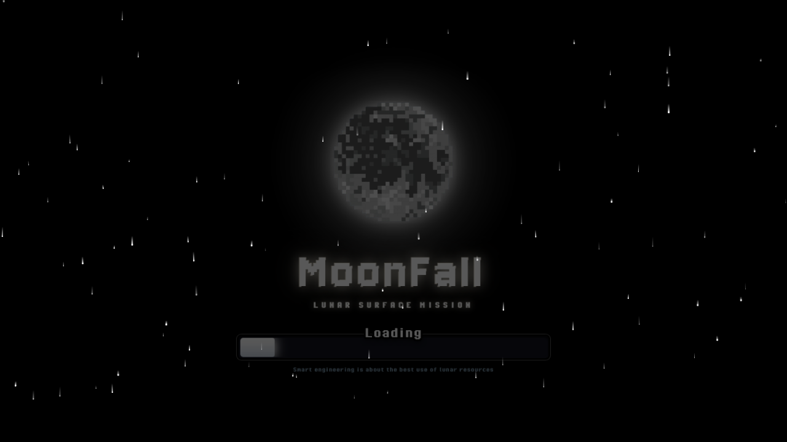 | 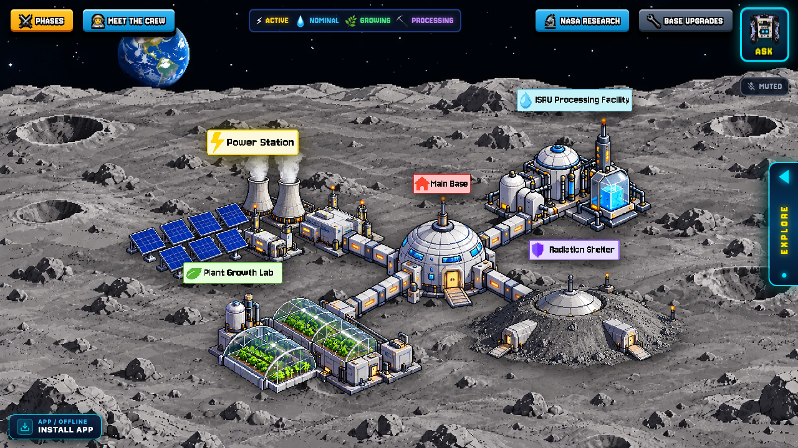 |
| *Cinematic landing sequence, glowing Moon, and mission initialization* | *Real-time telemetry HUD, 4 primary base modules, and Earth uplink* |

| 🎯 2-Tier Mission Selection Hub | 👨‍🚀 Phase 1 Cadet Training Roster |
|:---:|:---:|
| 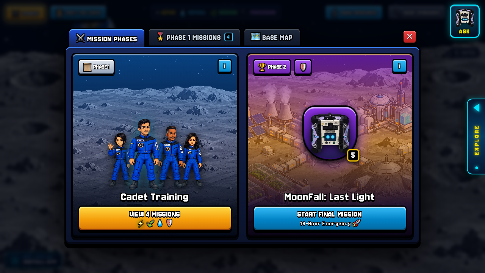 | 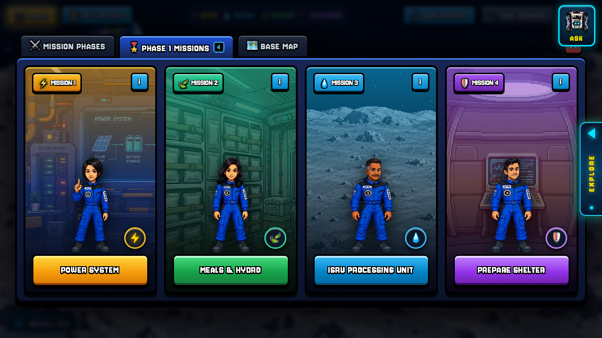 |
| *Clash of Clans style hub: Cadet Training vs. MoonFall Last Light* | *4 subsystem simulations led by historical astronaut guides* |

---

### 2. Character Mentorship & Real-Time AI Support
Learn lunar survival systems through historical space pioneers representing NASA, JAXA, and ISRO, supported by our intelligent AstroBee copilot.

| 📋 Astronaut Crew Manifest & Biographies | 💬 Character Dialogue & Onboarding |
|:---:|:---:|
| 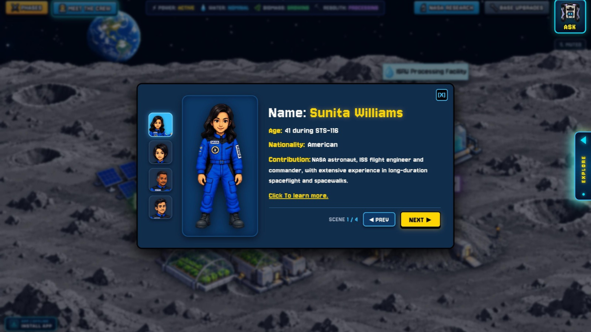 | 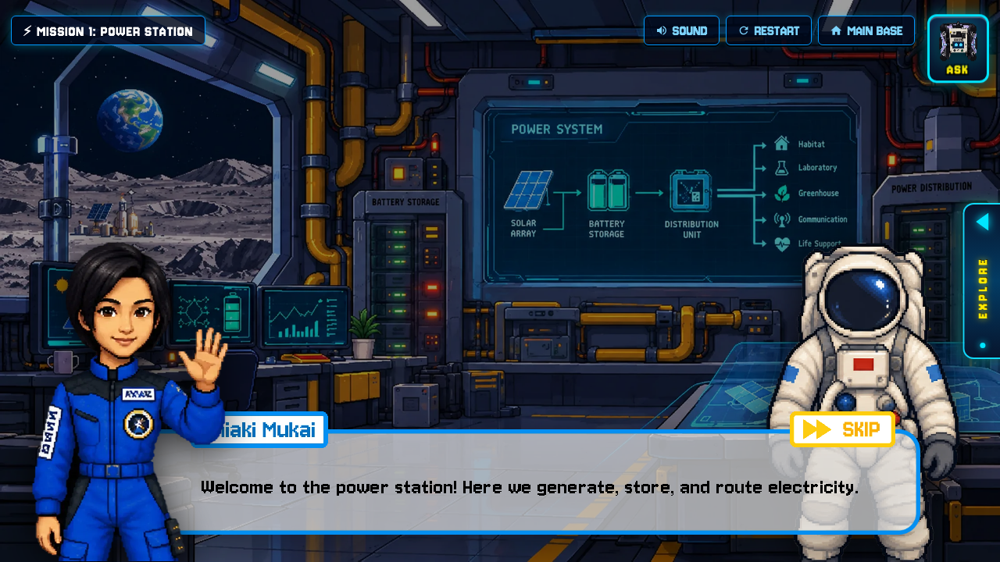 |
| *Biographical records, mission flight hours, and technical domains* | *Dr. Chiaki Mukai introducing power station distribution architectures* |

| 🤖 AstroBee AI Mission Copilot | 📚 NASA Open Science Research Sidebar |
|:---:|:---:|
| 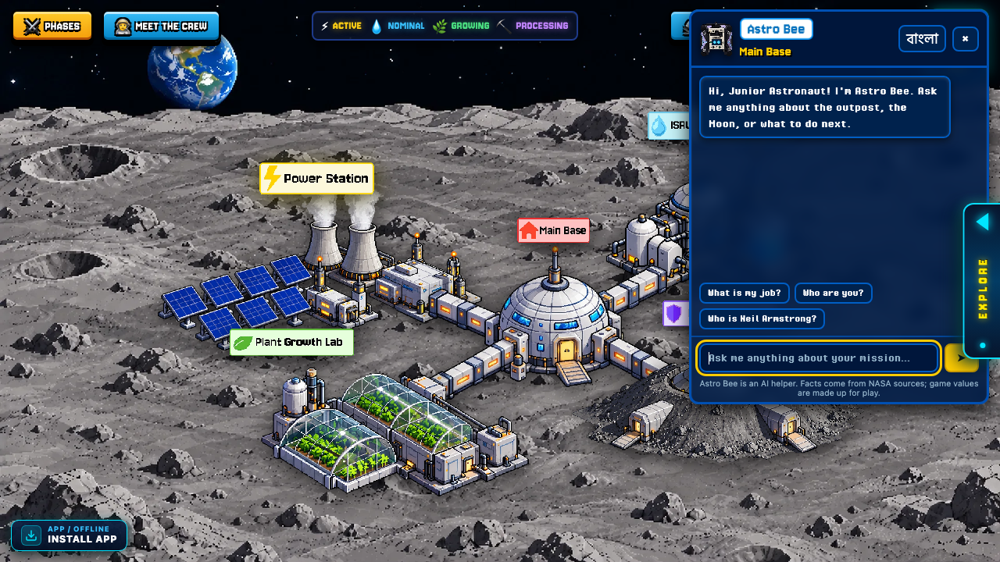 | 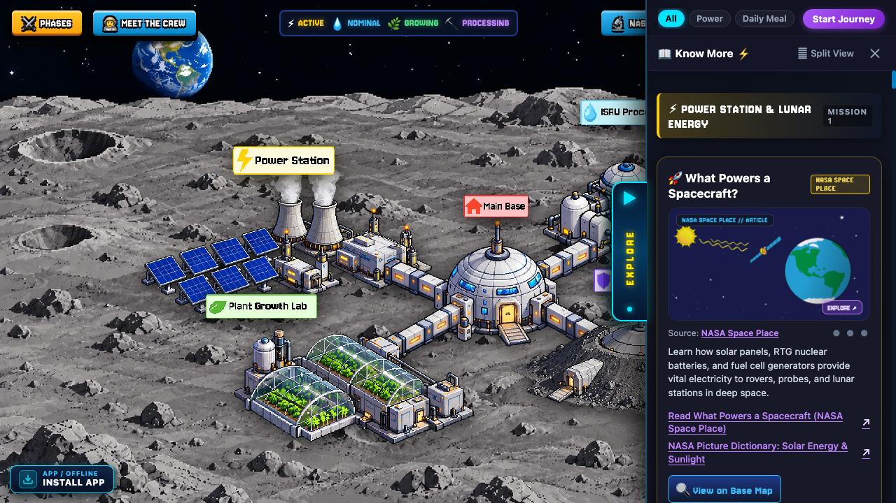 |
| *Interactive AI assistant providing contextual facts, advice & bilingual chat* | *In-game research dossier citing NASA CCMC, OSDR, and LSII open data* |

---

### 3. Interactive STEM Engineering Missions
Every simulation challenges cadets with thermodynamic formulas, life-support balances, and real NASA engineering trade-offs.

| ⚡ Power Generation & Solar Array (M1) | 🍃 Space Food System & Calorie Balancing (M2.1) |
|:---:|:---:|
| 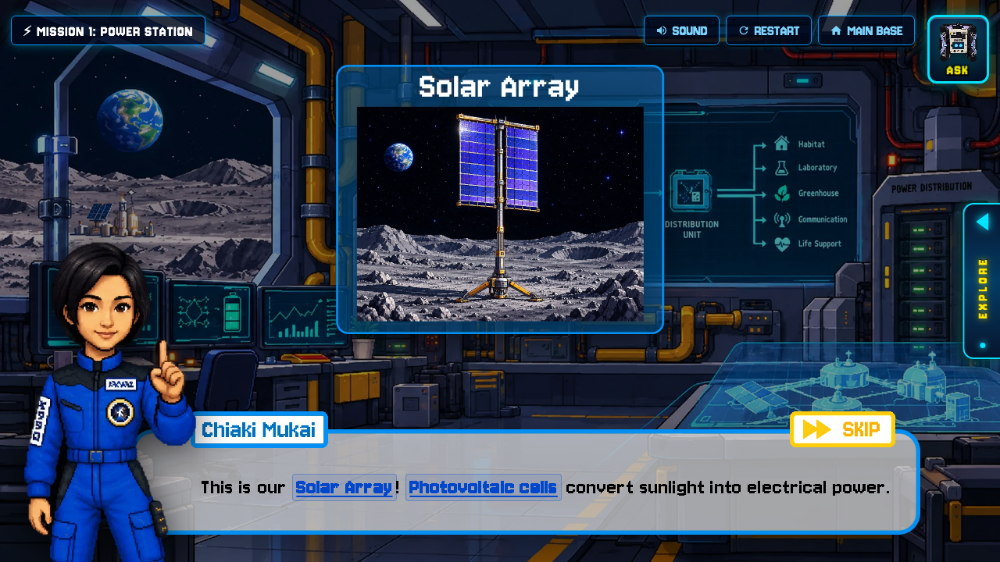 | 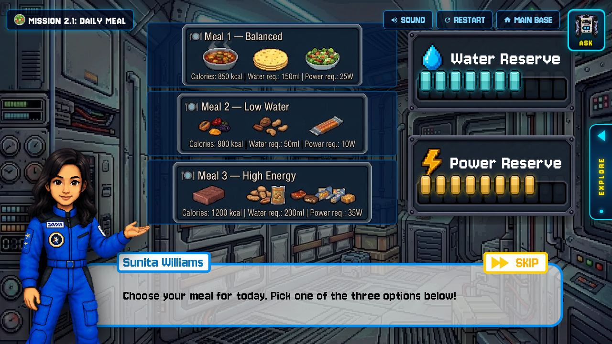 |
| *Photovoltaic solar generation vs. Kilopower fission reactor baseload* | *Balanced 2,500 kcal daily intake with hydration & power trade-offs* |

| 🌱 Hydroponic Regolith Greenhouse (M2.2) | 💧 ISRU Thermal Regolith Sublimation (M3) |
|:---:|:---:|
| 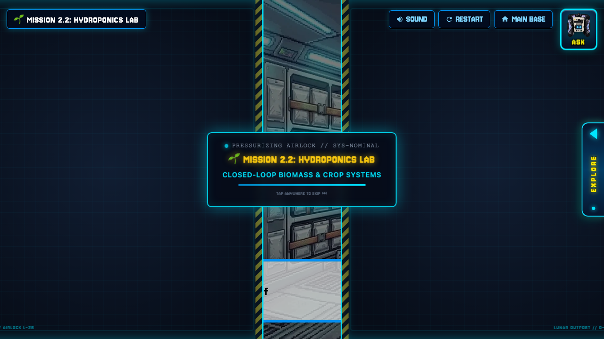 | 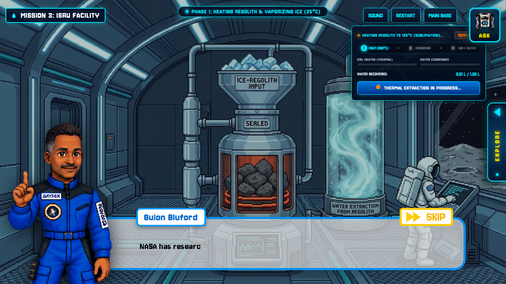 |
| *Closed-loop biomass growth, LED spectrums, and regolith toxicity controls* | *Heating regolith to $120^\circ\text{C}$ to vaporize and condense trapped ice* |

| 🛡️ Radiation Shielding & Regolith Barrier (M4) | 🚨 Phase 2: MoonFall Last Light (18-Hr Crisis) |
|:---:|:---:|
| 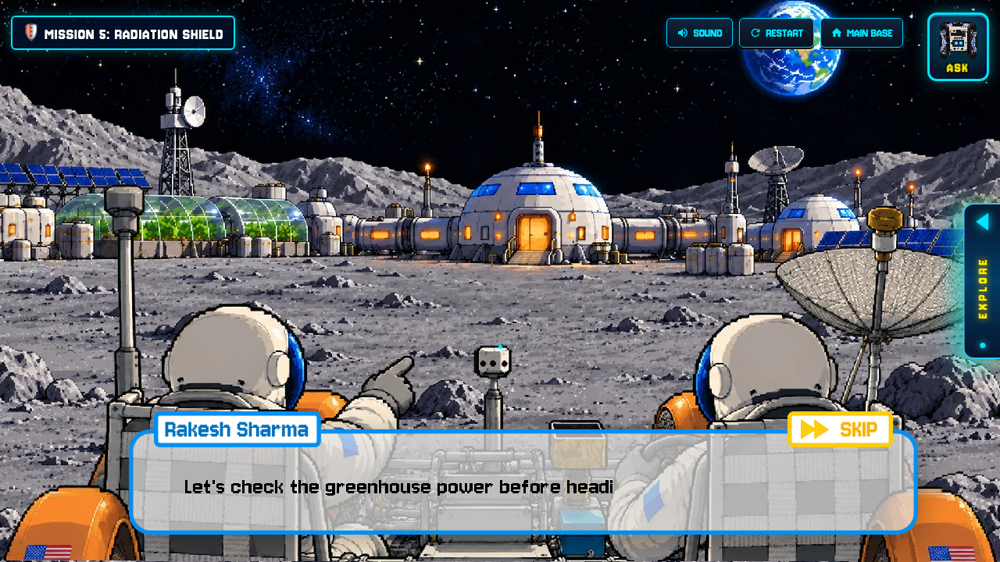 | 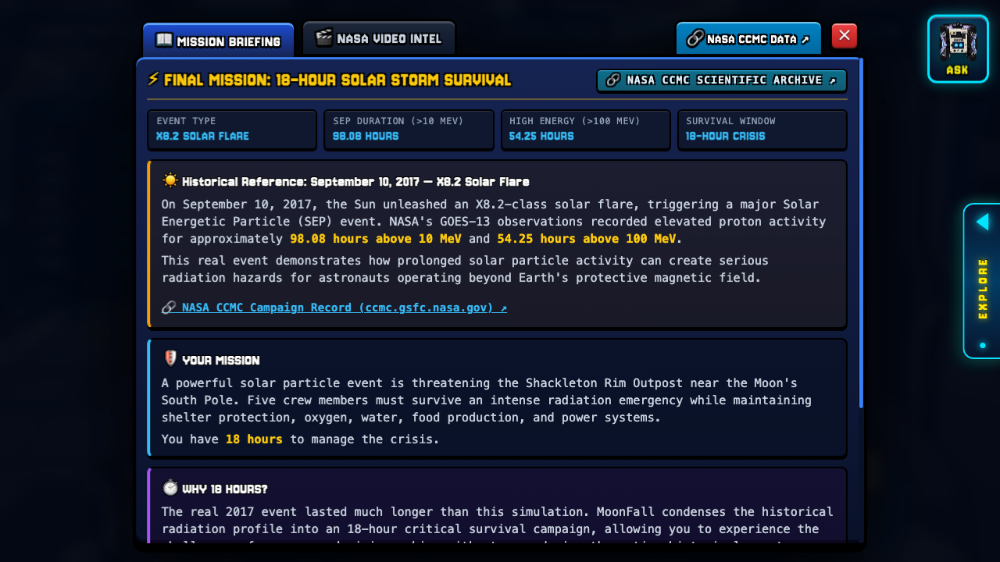 |
| *Rover traverse to Radiation Shelter and SPE dose mitigation* | *Live Solar Storm emergency countdown, telemetry limits & crisis choices* |

---

### 4. Dynamic Performance Evaluation & Star Ratings
Mission outcomes evaluate your survival efficiency, resource preservation, and command decisions across 4 distinct result states.

| ⭐⭐⭐ 3-Star Result (Outstanding) | ⭐⭐✩ 2-Star Result (Resilient) |
|:---:|:---:|
| 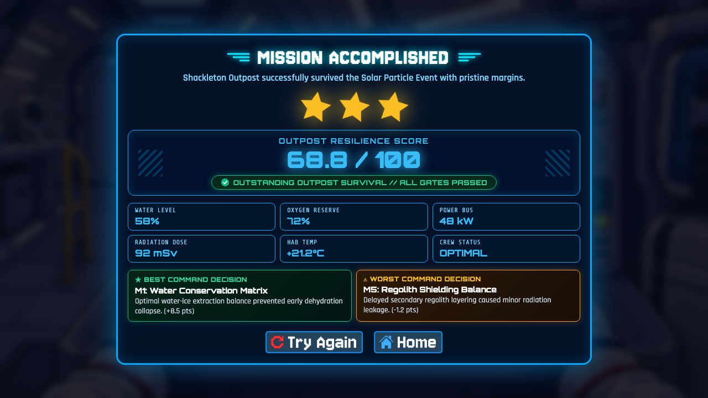 | 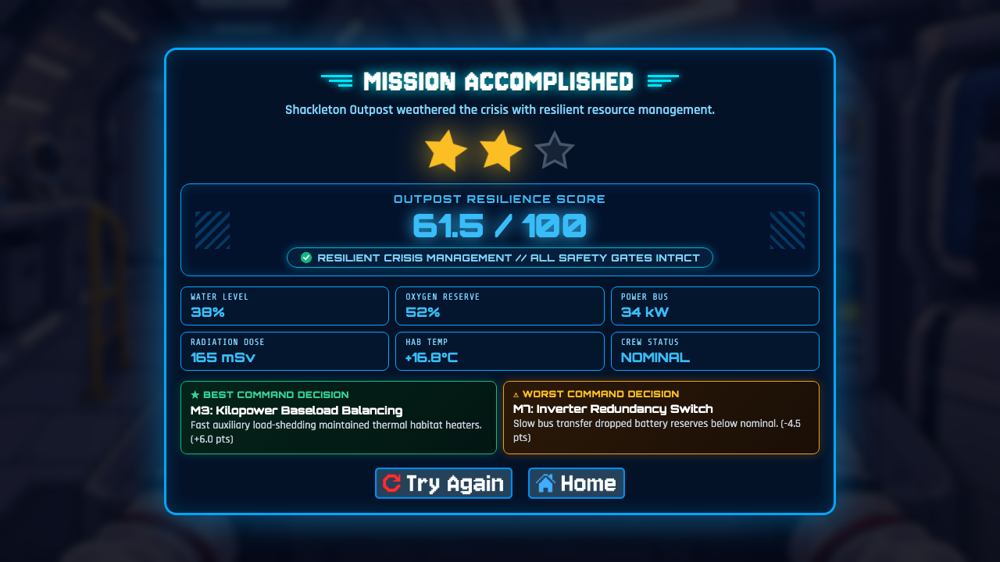 |
| *Score $\ge 66.0$: Outstanding outpost survival, all safety gates passed* | *Score $\ge 60.0$: Resilient crisis management, minor resource degradation* |

| ⭐✩✩ 1-Star Result (Marginal) | ❌ Critical Outpost Failure |
|:---:|:---:|
| 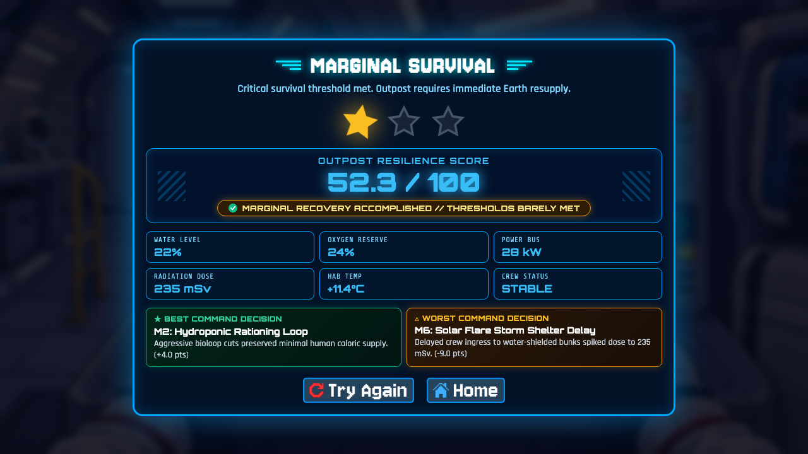 | 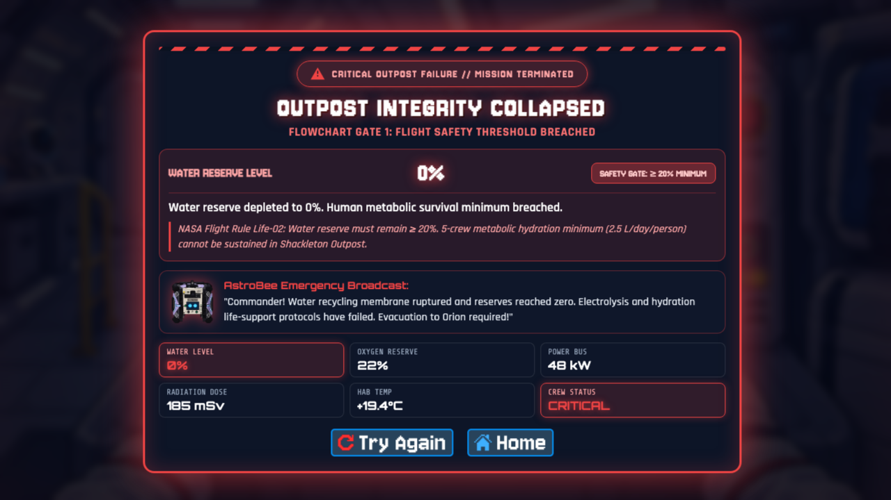 |
| *Score $\ge 50.0$: Marginal recovery, outpost requires immediate resupply* | *Score $< 50.0$ or Gate Breached: Outpost integrity collapsed* |

---

## 🧮 Game Logic & Mathematical Simulation Mechanics

MoonFall replaces static quiz gameplay with an authentic **thermodynamic state-space simulation engine**. During the 18-hour lunar night crisis, players navigate a branching decision graph of **1,296 possible survival trajectories** (8 sequential mission stages with 2 or 3 engineering options each).

### 1. State Space & NASA Scaling Factors
Outpost survivability is governed by 7 interdependent telemetry variables scaled directly from NASA flight operational baselines:

| Telemetry Variable | Baseline | Real-World Equivalent | Flight Rule Operational Basis |
|---|:---:|---|---|
| **Atmospheric $\text{O}_2$** | **75** | $10.1\text{ kg}$ (3 days for 5 crew) | $0.895\text{ kg O}_2$/day per astronaut (**NASA BVAD Rev 2**) |
| **Potable $\text{H}_2\text{O}$** | **65** | $325\text{ kg}$ drinking & hydration | $\ge 2.5\text{ L}$/day per astronaut (**NASA OCHMO-TB-027**) |
| **Battery Energy** | **75** | $75\text{ kWh}$ stored reserve | Baseload power for scrubbers, heaters & electrolysis |
| **Food Reserves** | **90** | $324\text{ kg}$ (30-day caloric buffer) | $2,500\text{ kcal}$/day intake at $2.39\text{ kg}$ rations/day |
| **Radiation Margin** | **65** | $650\text{ mSv}$ crew biological tolerance | Outpost storm shelter dose $< 250\text{ mSv}$ (**NASA-STD-3001**) |
| **Equipment Integrity** | **90** | $90\%$ hardware subsystem health | Micrometeorite seals, bus redundancy & inverter health |
| **Bioloop Canopy** | **80** | $16.0\text{ m}^2$ hydroponic regolith crops | Biomass closure rate & supplemental oxygen cycling |

---

### 2. Resilience Scoring Equation
Final mission success is scored using the normalized resilience objective function:

$$J = \frac{1}{7} \sum_{i=1}^{7} s_{8,i} = \frac{\text{O}_2 + \text{H}_2\text{O} + \text{Power} + \text{Food} + \text{Health} + \text{Equip} + \text{Greenhouse}}{7}$$

Starting from an initial base average of **$77.1$**, every crisis event imposes real thermodynamic entropy and electrical drain that players must mitigate through command triage.

---

### 3. Continuous NASA Failure Gates
After every decision stage ($M_1$ through $M_8$), the flight computer checks all telemetry against non-negotiable survival thresholds:

$$\text{O}_2 \ge 20\% \quad\Big|\quad \text{H}_2\text{O} \ge 20\% \quad\Big|\quad \text{Health} \ge 500\text{ mSv} \quad\Big|\quad \text{Power} > 0\% \quad\Big|\quad \text{Equip} \ge 50\%$$

$$\text{Life Support Index (LSI)} = \frac{\text{O}_2 + \text{H}_2\text{O} + \text{Food}}{3} \ge 50\%$$

> [!CAUTION]
> If **any single threshold is breached**, automated outpost abort is triggered, ending the run in **Critical Outpost Failure**, regardless of overall aggregate score.

---

### 4. Permutation Distribution (1,296 Tested Paths)
A Monte Carlo verification of all $1,296$ discrete paths reveals a balanced, high-fidelity difficulty curve:

| Star Rating | Objective Criteria | Path Frequency | Operational Interpretation |
|---|---|:---:|---|
| ⭐⭐⭐ **3 Stars** | Score $\ge 66.0$ & All Gates Passed | **10.4%** | Optimal flight performance; flawless resource management |
| ⭐⭐✩ **2 Stars** | Score $\ge 60.0$ & All Gates Passed | **49.6%** | Resilient crisis handling; minor subsystem degradation |
| ⭐✩✩ **1 Star** | Score $\ge 50.0$ & All Gates Passed | **19.3%** | Marginal recovery; habitat requires emergency Earth resupply |
| ❌ **Failed Run** | Score $< 50.0$ OR Any Gate Breached | **20.7%** | Habitat depressurization, blackout, or fatal radiation exposure |

### 5. Why Greedy Decisions Fail
A primary pedagogical feature of the flight logic is that **greedy short-term choices guarantee eventual mission collapse**:
- Selecting the choice with the highest immediate positive delta at each step (e.g. `B-A-B-B-A-A-B-B`) depletes radiation margins, causing crew health to breach the $500\text{ mSv}$ gate during the Module 4 bus explosion at $M_7$.
- Achieving a ⭐⭐⭐ 3-Star outcome requires players to adopt real aerospace engineering principles: anticipating cascading subsystem dependencies, accepting measured equipment sacrifices, and prioritizing human physiology over inanimate hardware.

---

### 6. Scientific Documentation & Simulation Proofs
MoonFall's state space and game logic are fully documented and proven through formal aerospace white papers, NASA baseline data mappings, and exhaustive Monte Carlo branch simulations.

> [!NOTE]
> Detailed white papers and datasets are available in the repository:
> - 📄 **[game_logic.pdf](game_logic.pdf)** — *Full 7-page NASA mathematical derivation, Townsend radiation models & flight balance proofs*
> - 📋 **[GAME_LOGIC_EXECUTIVE_SUMMARY.pdf](GAME_LOGIC_EXECUTIVE_SUMMARY.pdf)** — *Executive proof & 1,296-branch code verification*
> - 📊 **[VALUES.md](VALUES.md)** — *Canonical state delta values, real physical units & optimal path specifications*
> - 🗺️ **[1.html](1.html)** — *Interactive single-row decision tree flowchart with automated camera tour*

| 📋 Executive Proof & Physical Equivalents | 📄 NASA Baseline & Mathematical Model |
|:---:|:---:|
|  |  |
| *Executive proof validating state-space telemetry against NASA BVAD and NASA-STD-3001* | *Mathematical formulation, discrete transition function $s_k$, and physical unit mappings* |

| 📊 1,296 Exhaustive Branch Simulation Table | 📈 SPE Radiation Attenuation & Score Curves |
|:---:|:---:|
|  |  |
| *Table 2: Verification of all 1,296 paths with survival percentages and 3-star yields* | *Townsend BRYNTRN radiation shield models and Monte Carlo outcome distribution* |

| ⚙️ Verification Architecture & Balancing Pipeline | 🗺️ 18-Hour Crisis Decision Tree Flowchart |
|:---:|:---:|
|  |  |
| *Processing diagram linking NASA CCMC GOES proton data to game runtime* | *End-to-end flight decision graph across 8 missions, continuous failure gates & star tiers* |

---

## 🌟 Key Features
- **Authentic Scientific Formulas**: Sublimation thermodynamics, Kilopower fission decay curves, and regolith radiation absorption.
- **Zero-Dependency Web Stack**: Built using pure HTML5, vanilla CSS3, and JavaScript running at a steady 60 FPS.
- **Progressive Web App (PWA)**: Installable directly on Windows, macOS, Android, and iOS for distraction-free landscape play with offline caching.
- **Bilingual AstroBee Assistant**: Built-in AI copilot supporting English and Bengali (বাংলা) for inclusive STEM education worldwide.

---

## 🔬 NASA Open Data Grounding
- **NASA LSII (Lunar Surface Innovation Initiative)**: Regolith water sublimation and extraction thermodynamics.
- **NASA CCMC / DONKI**: Real-world Coronal Mass Ejection (CME) and Solar Particle Event (SPE) modeling.
- **NASA OSDR (Open Science Data Repository)**: Space radiation biodosimetry and crew physiological limits (NASA-STD-3001).

For a detailed analysis of our scientific mapping and rubric alignment, please see **[JUDGING_CRITERIA.md](JUDGING_CRITERIA.md)**.

---

## 🚀 Play Online
Launch the simulation directly in your browser:
👉 **[https://moonfall-blush.vercel.app/](https://moonfall-blush.vercel.app/)**

---

## 📄 License
This project is open-source under the **[MIT License](LICENSE)**.

